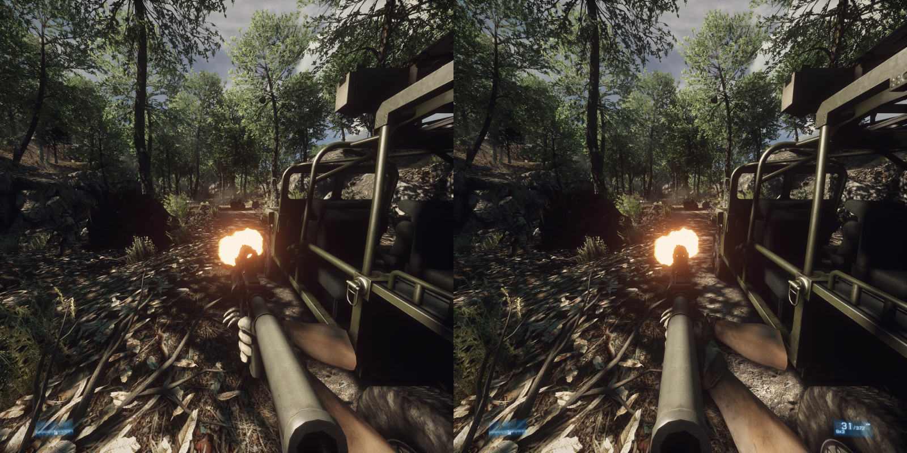
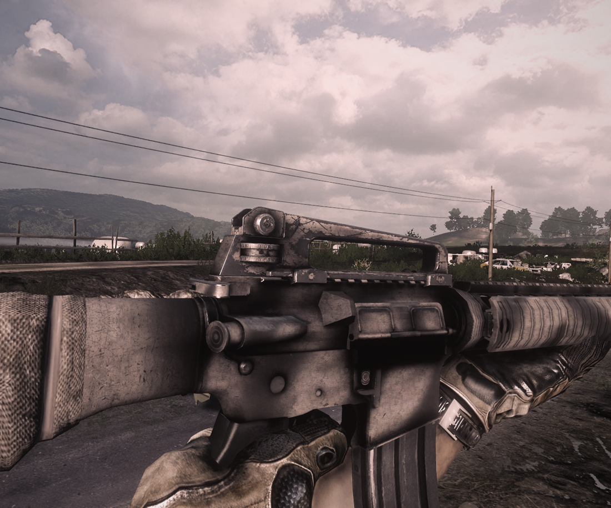
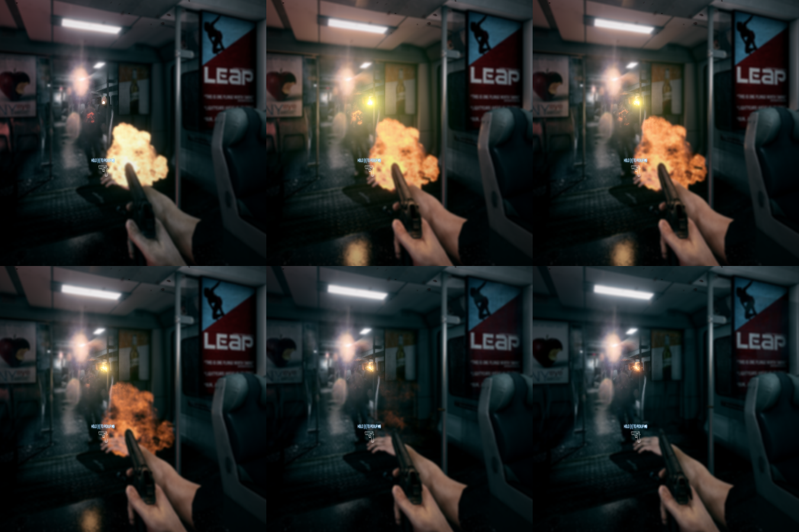

# Battlefield 3 VR: The Great Destroyer

A fan-made VR mod for the **Battlefield 3 campaign** on PC: the game in true 3D in your headset, your head moving the view, and your own hands holding, aiming and reloading the guns.
You need your own copy of Battlefield 3; the mod adds only its own code.

**This is a pre-alpha test build.** God mode is on by default, on purpose, and it isn't ready for a normal play-through yet: [read what that means](#pre-alpha-please-read) before you play.

**[Download it from the Releases page](https://github.com/criminalvictory/Battlefield-3-VR-The-Great-Destroyer/releases)**, then follow [Download and play](#download-and-play): unzip, double-click, play.

**Watch it:** [4-minute gameplay clip of Rock and a Hard Place, on X](https://x.com/PCVRGamer/status/2117429358998478896)



**On this page:** [Pre-alpha](#pre-alpha-please-read) · [What works](#what-works-today) · [Download and play](#download-and-play) · [Controls](#controls) · [Mission by mission](#what-to-expect-mission-by-mission) · [Troubleshooting](#troubleshooting) · [Campaign only](#campaign-only) · [Credits](#contributors-and-credits) · [For developers](#for-developers)

## Pre-alpha: please read

This is a **test build**: an early version for people who want to try it and say what goes wrong. It isn't a finished way to play the campaign yet.

- **God mode is on by default, on purpose.** Enemy fire can't kill you, so you can try the guns, the reloads and the levels without replaying the same fight again and again. It's a choice for testing, not a cheat left in by mistake. **End** on the keyboard switches it off (and on again), and the choice is remembered (`[god] enabled` in `build\bf3vr.ini`). The game's own ways of failing a mission still happen, such as leaving the mission area or a scripted death.
- **Not for a normal play-through yet.** One mission, Rock and a Hard Place, plays from start to end in VR. A few others have been partly played, and most not at all yet: see [mission by mission](#what-to-expect-mission-by-mission). Some guns are still held by the game's own hands.
- **Expect rough edges:** things that look or feel wrong, the odd crash, and settings that may need a change on your PC.
- **Holsters are switched off** in this build: they're built but not tested yet. Switch weapons with the buttons.
- **Tried on one PC so far:** Steam's copy of the game, a Steam Frame headset, an RTX 3080 graphics card, played seated. The buttons for Quest and Index controllers are set up, but nobody has tried them yet. Reports from other setups are very welcome: see [reporting a problem](#reporting-a-problem).

## What works today

- **True 3D:** the game draws a separate picture for each eye, 106 degrees wide.
- **Your head moves the view:** look around, lean, duck and peek. Cutscenes and rides stay in 3D: your body stays in the scene, your head stays free.
- **Your hands are your hands:** the gun is in the hand that holds it, pointing where you point it, and the other hand is free. Either hand can hold a gun, and both hands can hold a rifle. Let go of the grip and the gun drops; lower a hand towards a gun on the ground and squeeze, and it flies into that hand, an enemy's gun too.
- **The guns:** every gun of Rock and a Hard Place (the M416 with its M320 grenade launcher, the M16A4, M4A1, AN-94, AEK-971, AK-74M, RPK-74M, G3A3, KH2002 and M240, the SMAW and the Stinger), the M4A1 with its holographic sight in Operation Swordbreaker, and the pistol on the train.
- **Reloading by hand on all of them, and no automatic reloads:** take a fresh magazine from your belly and push it into the gun. Guns with a magazine button drop the old one when you press it; guns without one (the AK family, the G3) have it pulled out by hand, or knocked out by the new one. Then work the lever or the charging handle, or slap the bolt release on the M4s and the M16, whose port cover opens and shuts.
- **The M240's whole reload:** lift the lid, swap the ammo box, lay the belt in the feed, close the lid, pull the lever. The belt gets shorter as you fire.
- **The launchers too:** pull the spent case off the SMAW and load a new rocket; open the M320 by pulling its trigger once it's empty, put in a 40 mm round and slap it shut; lift the Stinger's aerial after each shot for the next missile.
- **Recoil and vibration:** each gun kicks with its own recoil (the rocket launchers not yet), and the controllers buzz with every shot. Fired with one hand, a rifle jumps all over the place, on purpose: use two hands.
- **Scopes that really magnify:** the zoomed view sits inside the scope's own glass, with its reticle and range marks, while the rest of your view stays normal. The Kobra red dot and the M4A1's holographic sight show their reticles.
- **Effects from the gun you hold:** the muzzle flash and smoke come from its barrel, and the casings fly out of its ejection port.
- **Moving as the soldier:** walk with the stick the way you look; crouch, go prone and stand up with the right stick, or crouch for real.
- **The game's own sounds** for the reloads by hand, made from your own copy of the game the first time you start.
- **A flat view for streaming:** the monitor, OBS and Discord show a normal picture, not two eyes side by side.



**Not there yet:**

- Most missions haven't been played in VR yet. Where you play someone else (Dima in Comrades and Kaffarov, the tank and the jet), the arms and guns are still the game's own.
- Guns the mod doesn't know yet (the shotguns, the AKS-74u, SVD, SKS, AS Val, Mk11, M249, PKP, AT4, Javelin, RPG-7 and others) stay in the game's own hands: they may reload by themselves and have no recoil of the mod's.
- Hand grenades aren't on the controllers yet (G on the keyboard throws one the game's way). No knife and no ladders by hand.
- Holsters are off in this build.
- The HUD isn't placed for VR yet, and some black can show at the far edges of the view when you turn your head fast.
- In scripted fights the game asks for keyboard keys: see [Controls](#controls) for which button is which key.



## Download and play

### What you need

- **Battlefield 3 for PC**, from Steam or the EA app, installed and **started once the normal way** first (so it makes its settings and links your EA account). Only the single-player campaign is used.
- **Steam with SteamVR** (SteamVR is free in Steam's Store).
- **A headset that works with SteamVR**, with thumbstick controllers: Meta Quest 3 or Quest 2 (through Steam Link, Virtual Desktop, or Quest Link / Air Link), Valve Index, Steam Frame, and others that SteamVR runs.
- **A strong graphics card:** it's made on an RTX 3080 at 72 frames a second. A slower card can make the picture smaller: see [low frame rate](#troubleshooting).
- **Windows 10 or 11.** Nothing else to install: no Visual C++ runtime, nothing put in the game's folder.

### Install (once)

1. **Download** the zip (`BF3-VR-0.1.0-prealpha.zip`, or whatever the newest one is called) from the [Releases page](https://github.com/criminalvictory/Battlefield-3-VR-The-Great-Destroyer/releases).
2. **Unblock it:** right-click the zip, **Properties**, tick **Unblock** at the bottom, **OK**. Windows marks downloaded files; unblocking the zip before unzipping keeps it from stopping the mod's files one by one. (No Unblock box: nothing to do.)
3. **Unzip it:** right-click the zip, **Extract All...**, and pick any folder you like (Documents, the desktop...). Keep the folder together, and don't start anything from inside the zip itself.
4. **If your antivirus complains:** the mod's `build\injector.exe` puts the mod (`build\bf3vr.dll`) into the running game. That's how many game mods work, but it's also something harmful programs do, and these files are new and unsigned, so some antivirus programs (Windows Security among them) may block them or move them to quarantine. Everything in the zip is built from the code on this page. If the launcher says a file is missing or your antivirus removed it, restore it from the antivirus' quarantine (in Windows Security: Virus & threat protection, Protection history), allow it, and unzip again if needed. Allow only these files or this folder; never switch your antivirus off.

### Connect the headset

Every time, before you start: turn the headset on and connect it to SteamVR.

- **Meta Quest 3 or Quest 2**, one of these:
  - **Steam Link** (free, from the Meta Store on the headset): open it in the headset and pick your PC.
  - **Virtual Desktop**: connect to your PC; SteamVR streams through it (the launcher starts SteamVR if it isn't running).
  - **Quest Link** (cable) or **Air Link** (Wi-Fi), through the Meta Quest Link app on the PC.

  With Quest Link or Air Link, Meta's OpenXR runtime is usually the active one on the PC. The mod asks for SteamVR's by itself, but to be sure: in SteamVR's **Settings**, **OpenXR** (in older versions under **Developer**), click **Set SteamVR as OpenXR Runtime**. (To give it back to Meta later for other games: the Meta Quest Link app, Settings, General, OpenXR Runtime.)
- **Valve Index**, **Steam Frame** and other SteamVR headsets: as you always do. With the Steam Frame's USB adapter plugged in, the launcher waits for its link and makes sure SteamVR streams over it.

Set the headset to **72 Hz**, the rate the mod is made and tested at (in Steam Link's, Virtual Desktop's or the Meta Quest Link app's settings, or SteamVR's). The Index can't do 72: use 80 Hz, its lowest.

### Play

1. Double-click **`Start BF3 VR.bat`** in the unzipped folder. If Windows asks first ("Open File - Security Warning": **Run**; or "Windows protected your PC": **More info**, **Run anyway**), let it: that's the zip not being unblocked.
2. A window opens and says what it's doing. **Leave it open.** It checks your PC, sets the game to windowed if it was full screen (the mod needs a window; your old settings file is kept), makes the mod's sounds from your copy of the game the first time (about a minute, once), starts SteamVR, and starts Battlefield 3: Steam's copy through Steam, which opens Battlelog in your browser; the EA app's copy by opening Battlelog in your browser.
3. **In Battlelog, click PLAY CAMPAIGN.** Sign in with your EA account if it asks (the launcher never touches your account). If your browser asks whether to open the EA app, allow it. If PLAY CAMPAIGN opens the campaign page instead, click its **LAUNCH CAMPAIGN** button.
4. When the window says **"The mod is in"**, the game is starting with the mod.
   - **The first time:** in the game's menu click **START NEW CAMPAIGN** and pick a difficulty (or **RESUME CAMPAIGN** if you've played the campaign before).
   - **From then on** the window clicks RESUME CAMPAIGN for you.
5. **Put the headset on as the level starts:** the game switches to VR by itself (the menus before it are a flat screen). Sit or stand the way you'll play, look straight ahead and hold the right stick's click for 1.5 s to recenter (F9 on the keyboard does the same).

**The next time:** connect the headset, double-click `Start BF3 VR.bat`, click PLAY CAMPAIGN, put the headset on.

- **Another mission:** press Escape in the game, EXIT TO MENU, then REPLAY MISSIONS (it lists the missions you've finished). If the mouse misses in the menus while the VR view is on, use the arrow keys and Enter, or press F8 for the flat screen (and F8 again for VR).
- **A newer release:** unzip it into a new folder and start from there.
- **Uninstall:** delete the folder. The only change it makes outside it: a game set to full screen is set to windowed, its old settings file kept as `Documents\Battlefield 3\settings\PROF_SAVE_profile.before-bf3vr`. To undo that, put that file back in place of `PROF_SAVE_profile`, or set full screen again in the game's options.

## Controls

The controllers work only while the game's window is in front on your PC: if you clicked anything else, click the game's window once.

### The same on every controller

| | |
|---|---|
| Right trigger | Fire the gun in your right hand |
| Left trigger | Fire the gun in your left hand. With the hand on a charging handle, lever or pistol slide: grab it (pull back, let go). On the M320's grip: fire a grenade |
| Grip | Hold a gun. Keep squeezing: let go and it drops (unless the other hand holds it at the front) |
| The other grip, at the gun's front | Hold it with both hands: it then points from your back hand towards your front hand |
| Grip at your belly | A fresh magazine for the gun in your hands (or a rocket, or a 40 mm round) |
| Grip near a gun on the ground, or with your hand lowered towards it | The gun flies into that hand |
| Left stick | Walk, the way your head faces; click: sprint |
| Right stick | Turn; flick down: crouch; flick down and hold: prone; flick up: stand up |
| Right stick's click | Short: jump; held 1.5 s: recenter the view |

There's no aim button: bring the gun up to your eye and look through its sights.

### The buttons

| | Quest 3 / Quest 2 | Valve Index | Steam Frame |
|---|---|---|---|
| **Magazine:** tap to drop it (guns with a magazine button); hold for the game's own reload, or when the game says **HOLD [R]** to pick something up | **X** (left) | **A** (left) | **X** (right); with the gun in your left hand also **D-pad right** |
| **Use:** the game's **E** (doors, prompts) | **Y** (left) | **B** (left) | **Y** (right) |
| **Switch weapon** (rifle, launcher) | hold **Y** 0.7 s | hold left **B** 0.7 s; or press a trackpad hard: left the launcher, right the rifle | hold **Y** 0.7 s; or **D-pad** up the launcher, down the rifle |
| **Jump:** the game's **Space** | **A** (right) | **A** (right) | **A** (right) |
| Free | **B** (right) | **B** (right) | **B** |

On the Quest the left menu button switches weapons too, unless SteamVR keeps it for its own menu.

**In scripted fights** the game shows a key to press: **Space** is A, **E** is Y (Index: left B), **HOLD [R]** is holding X (Index: left A). For any other key, press it on the keyboard.

### The keyboard (with the game's window in front)

| Key | |
|---|---|
| F8 | The VR view, or a flat screen in the headset |
| F9 | Recenter |
| End | God mode off / on (remembered) |
| Home | What the monitor shows: one eye, or both side by side (remembered) |
| Insert | The mod's hands off / on (off: the game's own arms) |

The full list is under [Keys and settings](#keys-and-settings).

### By hand

- **Two hands:** with the gun in one hand, squeeze the other grip at its handguard. Let go of that grip to free the hand.
- **Drop and take back:** open your hand and the gun falls (or flies, if your hand was moving). To get it back, lower your hand towards it and squeeze.
- **Reload:** drop the old magazine (the magazine button, on guns that have one) or pull it out by hand (the AK family, the G3; pushing a new one against it knocks it out too). Squeeze at your belly for a full one, bring it under the magazine well top first and push it home. If the gun ran empty: put your hand on the charging handle or lever, hold that hand's trigger, pull back and let go; on the M4s and the M16 you can instead slap the bolt release, on the left behind the magazine well, with an open hand.
- **Pistol:** the other hand's trigger on the back of the slide grabs it: pull back, let go. The magazine button drops the magazine; a new one comes from your belly.
- **SMAW:** grab the spent case at the back, twist or pull it off, take a rocket from your belly and push it in until it locks.
- **M320 (under the M416):** squeeze at its own grip, under the barrel in front of the magazine: that hand's trigger fires a grenade, and the other trigger still fires the rifle. When it's empty, pull its trigger to open it, the spent case falls out, take a round from your belly, push it in and slap the barrel shut.
- **Stinger:** hold it on the jet until you hear the lock tone, then fire. Lift the aerial after each shot for the next missile.
- **M240:** lift the lid, swap the box (from your belly), pinch the belt with your thumb and finger and lay it in the feed, close the lid, pull the lever.
- **Holding the magazine button** is always the game's own reload, if you'd rather.

## What to expect, mission by mission

A new campaign starts at the first mission, and the game's REPLAY MISSIONS lists only missions you've finished. If your copy has played the campaign before, you can pick any of those.

| # | Mission | With the mod so far |
|---|---|---|
| 1 | Semper Fidelis | Where a new campaign starts. Not yet played with the mod from here, but it's the same train, arms and pistol as in The Great Destroyer, which have been played, so it should go the same way: the game's own hands in the scripted opening and fights (for the keys they ask for, see [Controls](#controls)), then your bare hands and the pistol, with its slide and magazine by hand. The shotgun at the jammed door and the AKS-74u stay in the game's own hands. |
| 2 | Operation Swordbreaker | Played: the M4A1 with its holographic sight, reloads by hand, recoil, enemy guns taken off the ground. On the hotel roof, hold the magazine button when the game says HOLD [R] for the launcher. The Mk11, the M249 and the other guns new here are in the game's own hands. The frame rate dips below 60 on the opening street. |
| 3 | Uprising | Not played in VR yet. |
| 4 | Going Hunting | Not played in VR yet (the jet's back seat). |
| 5 | Operation Guillotine | Not played in VR yet. |
| 6 | Comrades | The opening drive played: in 3D around you, your body in the car, your head free. You play Dima here: his arms and guns are still the game's own. |
| 7 | Thunder Run | Not played in VR yet (a tank). |
| 8 | Fear No Evil | Not played in VR yet (a tank). |
| 9 | Night Shift | Not played in VR yet. |
| 10 | Rock and a Hard Place | The one mission played from start to end in VR: the car ride, every gun of it in your hands, the SMAW against the BMPs and the Stinger against the jet. |
| 11 | Kaffarov | Not played in VR yet. |
| 12 | The Great Destroyer | Played as far as the train: the interrogation and its fight with the game's own hands (Space is A, then E is Y), then your bare hands and the pistol on the train. |

## Troubleshooting

**The launcher window stops with a message.** Its last lines say what's wrong and what to do (the game wasn't found, SteamVR isn't installed, a file is missing...). Press Enter to close it, fix that, and double-click again.

**The window says the mod's folders aren't there, or closes at once.** Unzip the whole zip first (Extract All) and start `Start BF3 VR.bat` in the folder that makes.

**Nothing in the headset.**
- The VR view starts with the level; the menus before it show as a flat screen. F8 switches between the two.
- SteamVR must be running and showing your headset: connect the headset first, then double-click.
- Quest with Quest Link or Air Link: make SteamVR the OpenXR runtime (see [Connect the headset](#connect-the-headset)).
- Other programs that hook the game's picture (ReShade and the like: a `dxgi.dll`, `d3d11.dll`, `d3d9.dll` or `dinput8.dll` in the game's folder) can fight the mod: move them out. The launcher warns about them.
- Keep the game windowed: in full screen the mod can't size its picture for the headset.

**The game started flat, without VR (the mod isn't in it).**
- Start through `Start BF3 VR.bat` every time, and click PLAY CAMPAIGN once its window says "The mod is waiting for the game". A game started any other way, or more than 10 minutes later, runs without the mod: close it and start again.
- A line starting with **REFUSED** means that game wasn't started as the campaign (multiplayer, co-op): the mod stays out on purpose. Close that game, then click PLAY CAMPAIGN.
- "Battlefield 3 is running as administrator": run neither the game nor the EA app as administrator (or run the launcher as administrator too).
- `build\injector.log` has everything the launcher's injector saw.

**The controllers do nothing.** Click the game's window once: the mod sends your buttons to the game only while its window is in front. Also check that the controllers are on and the headset sees them.

**The view is off to one side, too high or too low.** Sit or stand the way you play, look straight ahead, and hold the right stick's click for 1.5 s (or press F9).

**The soldier crouches or walks by itself when you only lean** (easy to do seated). With the game closed, open `build\bf3vr.ini` in Notepad and add these lines at its end:

```
[head]
crouch=0
walk=0
```

**Low frame rate or stutter.**
- Set the headset to 72 Hz (the Index: 80 Hz).
- With the game closed, lower `size` under `[window]` in `build\bf3vr.ini`. It's each eye's picture in pixels: 2400 by default, 106 degrees wide. At 2160 the view is 100 degrees wide, at 2000 about 95, at 1600 about 83: just as sharp, a little narrower, and much lighter for the graphics card.
- Lower the game's own graphics settings (OPTIONS, VIDEO) and close programs you don't need.

**No reload sounds.** The mod's reload sounds are made from your copy of the game the first time you start (`build\sounds`). If that failed, `build\gamesounds.log` says why: delete the `build\sounds` folder and start again to make them anew. They follow Battlefield 3's volume in Windows' volume mixer. (To only check things and make the sounds without starting anything: type `cmd` in the folder's address bar, Enter, then `"Start BF3 VR.bat" -Check`.)

**A crash, or anything else.** Please report it.

### Reporting a problem

Open an issue on this page's [Issues](https://github.com/criminalvictory/Battlefield-3-VR-The-Great-Destroyer/issues) tab. Say which mission, what you did and what happened, which headset and how it's connected, and your graphics card, and attach these from the unzipped folder's `build` folder:

- `bf3vr.log`: the mod's log. The next game start replaces it, so copy it before you start again.
- `injector.log`: how the game was started and whether the mod went in.
- `gamesounds.log`, if the sounds failed.

The logs name folders on your PC, which can include your Windows user name: look them over before you post them.

## Campaign only

The mod is made for the single-player campaign, and it refuses everything else by itself:

- the injector reads how each new Battlefield 3 was started and puts the mod only into Battlelog's **PLAY CAMPAIGN** start. A multiplayer or co-op start, or one it can't read, gets nothing, and the launcher window shows a **REFUSED** line;
- the mod checks again as it loads, and leaves at once, without touching anything, if the game isn't the campaign.

Never try to get round it: loading anything into the game on online servers can get your account banned. This project contains only its own code: it ships no EA files and none of the game's sounds (those are made on your PC from your own copy).

## Contributors and credits

- [DanInDev](https://github.com/DanInDev): ideas for the holsters (a buzz when a hand reaches a holster spot, and a check that the game really switched guns after a draw), shared from his own work on the same game engine.
- [FrostbiteVR](https://github.com/justiceofrip/FrostbiteVR): the per-eye picture is made the way FrostbiteVR renders Bad Company 2, the game itself drawing a second complete view for the other eye; this mod found the same in Battlefield 3's own code.
- The mod's programs are built with the [OpenXR SDK](https://github.com/KhronosGroup/OpenXR-SDK) (the Khronos Group, Apache 2.0, with JsonCpp) and [MinHook](https://github.com/TsudaKageyu/minhook) (Tsuda Kageyu, BSD 2-clause), and the scopes' upscaling filter is AMD's FidelityFX Super Resolution 1 (MIT). Their licences are in [THIRD-PARTY-NOTICES.txt](THIRD-PARTY-NOTICES.txt) and in the release's `licenses` folder.
- This is a fan project, not affiliated with or endorsed by Electronic Arts or DICE. Battlefield is a trademark of Electronic Arts.

---

## For developers

Everything below is about building the mod from source and how it works. Every change is logged in [CHANGELOG.md](CHANGELOG.md).

### Status

**Pre-alpha (experimental).** It becomes **alpha** when: the head's position moves the view, the gun sits in the right hand and
the left hand is free, every campaign weapon aims correctly, it installs from the download steps above
without the finder steps, and a whole mission plays through without a crash.

### Building

Needs Visual Studio with the C++ workload (it brings CMake and Ninja). Then run:

```
build.bat
```

This fetches the OpenXR SDK and MinHook and produces `build\bf3vr.dll`, `build\injector.exe` and the tools
(`build\gamesounds.exe` among them), with the C runtime built in. `tools\package.ps1` makes the release zip
from one commit: a clean build of it, the settings it's played with, checked for anything private.

### Running from source

`Start BF3 VR.bat` in the repository's root starts a build from source just as the release does (it uses
`build\`): SteamVR, the injector, the game, and the first start's sounds. By hand:

1. Start SteamVR.
2. Run `build\injector.exe`. It waits for the game, and puts the mod only into a campaign start.
3. Start the campaign from Battlelog. The mod loads a few seconds after `bf3.exe` starts, and switches to
   the headset's view by itself once the player's soldier is in a level.
4. Settings live in `build\bf3vr.ini` (created on first run); the log is `build\bf3vr.log`.

A fresh build has none of the settings files the release ships in its `build` folder (`bf3vr.ini`,
`weapon.txt`, `pickups.txt`, `recoil.txt`, `holsters.txt`, `grip.txt`, `pistol.txt`, `aimroute.txt`,
`m320grip.bin`): without them the mod starts from its own defaults, which aren't how it's played. Copy
them from the release into your `build` folder.

The mod fixes up a Steam quirk on its own: games launched while SteamVR runs get the 64-bit
runtime path, which a 32-bit game can't load. And with another OpenXR runtime active (a Quest's
Meta runtime), it points the game at SteamVR's 32-bit one (`[general] prefer_steamvr=0` leaves the
OpenXR loader's own choice).

### What works, in detail

- **Per-eye stereo** (the default): BF3 draws both eyes itself, every frame, from the same game
  state, each from its own camera half your eye distance from the middle of your head: real depth
  everywhere and no halo. It uses a developer setting the retail game still has,
  `GameRenderSettings.SplitScreenTestViewCount`: set to 2 the game draws a second complete view
  beside the first. `src/views.cpp` hooks the function that builds the frame's views and makes them
  the two eyes (the left eye in the left half, the right eye in the right half of a window twice as
  wide), and each eye is shown its half. This is how FrostbiteVR renders Bad Company 2 (a native
  second view), found in BF3's own code. BF3 draws the gun and arms of both views from one camera,
  so the free hands and gun are shifted per eye by the mod (the game's own arms, with free hands
  off, have no depth of their own). Two full views hold the headset's 72 fps with about 6 ms to
  spare a frame (tested in the campaign's opening level).
- **A steady frame rate**: every frame, BF3 asks Windows for the PC's memory statistics
  (`GetPerformanceInfo`), and Windows counts every process and thread on the computer to answer:
  11 ms of the 13.9 ms a frame has at 72 Hz, with SteamVR, a browser and the usual apps open
  (380 processes, 7,800 threads). Made in 2011, it took microseconds then. The mod answers it from
  a copy refreshed once a second (`src/perfinfo.cpp`); with two views the frames no longer missed
  the headset and turning with the stick stopped stuttering.
- **Stereo 3D from depth** (Ctrl + Scroll Lock): every game frame becomes both eyes. Each pixel is shifted
  sideways by the eye's offset over its distance, read from BF3's own depth buffer, so both eyes
  update every frame and head turns no longer double the picture (alternate-eye rendering, one
  frame per eye in turn, did). The gun and arms get their real depth too: BF3 draws them squeezed
  towards the eye and marks them in the stencil buffer, so the mod un-squeezes exactly those
  pixels. Cheaper than per-eye views, but around near things against far ones it shows a soft halo.
  Ctrl + Scroll Lock cycles per-eye views / depth 3D / hybrid / alternate eyes / mono / frozen; tuning is
  in `build\depth3d.txt` (see below).
- **Head tracking**: the head turns the picture, including tilt.
- **Motion controller aiming**: the right controller aims; bullets, muzzle flash and the gun model
  follow it. Buttons and sticks are sent to the game as keyboard and mouse, except the smooth turn:
  in stereo the right stick's turn goes into the look angle the mod writes each frame, which the
  picture follows, so it turns in step with the frames (`[controllers] turn_degrees`, 266° a
  second at full deflection). As a mouse move once a frame it stuttered: BF3 reads the mouse on a
  rhythm of its own, and about 6 times a second a frame barely turned and the next turned double.
  In theater mode the stick still moves the mouse, a little every millisecond.
- **Square window**: in windowed mode the game draws square (default 1600×1600), which gives
  more view top to bottom and a sharper headset image; with per-eye views twice as wide (3200×1600:
  each eye a square half). That may be bigger than the monitor, so the window on the desktop is fitted
  to the monitor instead (borderless, in the shape of the picture it shows) while the game still draws
  at that size: see [Streaming and recording](#streaming-and-recording).
- **Floating screen** (theater) mode as an alternative to stereo.
- **Wide field of view** (Delete on/off, Page Up / Page Down to tune, default 100°): the campaign
  renders a fixed 55° whatever the menu says, which in a headset looks like a square window. The
  mod widens the render, cull and first-person views each frame, and rescales the gun and arms'
  projection where it is uploaded to the graphics card, so they keep their real size. The
  headset image is shown at the same angle, so the world stays life-size.
- **Free hands** (Insert on/off, on by default): the gun is drawn in your right hand, pointing
  where the controller points, held where the game's own hand holds it, with its scope and stock;
  the left glove follows the left controller, its fingers following yours: the left trigger
  curls the index finger, the left grip the other three, and resting your thumb on the stick folds
  the thumb in (all three: a fist; the grip alone: pointing). Relaxed, the fingers are a little
  curved and apart. Each finger bends at its own joints (`src/handpose.cpp`), and three small
  cracks in the glove model that bending opens are filled. The arms, sleeves and body are folded
  away (floating hands). With "lineup 1" in `build\pouch.txt` (off, it was pressed by accident too
  often), the left View button on the Steam Frame lines the glove up: the first press holds it
  still, put your hand into it and press again (kept in `build\grip.txt`, with
  "spread 0.7" for how far apart the relaxed fingers are and "leftwidth 1.15" for the palm's
  width). Without one, the line-up made on the test setup's Steam Frame is used. BF3 draws the first-person arms in a space of their own whose origin jumps a metre at a
  time as you walk; each draw places the hands with the eye and axes of the view-projection it is
  drawn with, so they stay steady while moving.
- **Both hands on the rifle**: squeeze the left grip with the left hand at the handguard and the
  glove takes hold there (the game's own grip for this gun) until you let go of the grip. While it
  holds, the gun points from your right hand towards your left, and the game aims along it, as long
  as your left hand is where a handguard could be: with it beside, below or behind the right hand,
  or the hands closer than 10-15 cm, the right hand alone points the gun. The change eases in and
  out over about a tenth of a second, letting go too, and a sudden jump of the left controller's
  tracking can't throw the gun across the view. (Before, the rifle followed the left hand wherever
  it went while the grip was squeezed, and swung round in one jump.)
- **God mode** (End on/off, on by default): the campaign runs the game's own server inside
  `bf3.exe`, and the health that decides deaths is the server's copy of your soldier. The mod finds
  it every spawn and keeps health and maximum health at `[god] value` (100000), so hits are undone
  the next frame and the screen stays clean. Scripted deaths still happen (leaving the area of
  operation fails the mission).
- **Bodies stay** (`[world] corpse_seconds`, 600 here; 0 = the game's own 15 s): raises how long
  dead soldiers lie before the game removes them (tested: none of 12 removed in 3 minutes).
- **Magazine eject** (X): on guns with a magazine button (the M416, M16A4, M4A1, KH2002, the pistol)
  a tap drops the magazine out of the gun, and it falls to the ground. Its rounds go back to the spare
  ones and one stays in the chamber. Guns without a button (the AK family, the G3A3) have the magazine
  pulled out by hand, or knocked out by the new one. Holding X is the game's own reload. The gun
  doesn't fire with the magazine out or one round left (run dry, the game would reload by
  itself). The ammo is the count in the game's own server, which decides firing.
- **All ammo from the belly** (the rifle, the pistol, the launchers, the grenade launcher, any gun):
  with the magazine out, the bolt locked back on an empty one, or the grenade launcher open, bring
  the left hand to your belly and squeeze the left grip (nothing is drawn there). The gun's own
  magazine (or a 40 mm round) appears in the left glove. Bring it under the magazine well, top
  first: it's caught below the well's mouth, straightened as you push, slides only along the well,
  and seats when pushed home. Only then do its rounds go in. Let go of it on the way and it falls to
  the ground; let go of it at the belly and it goes back. With any other gun,
  squeezing there is the game's own reload. `build\pouch.txt` changes the place (`zone below forward
  reach`), turns it off (`pouch off`), lets a tap of X put a magazine in (`xinsert 1`), stops other guns
  from reloading there (`anygun 0`), and runs a scripted hand for pictures (`test 1`, `test 2 -0.05`).
- **Free hands** (every gun the mod has a hold for): the right grip button holds the rifle. Squeeze it once, and
  letting it go lets go of the rifle: it stays held by a hand on its handguard alone (still aimed,
  nothing fires) or it falls, or is thrown if the hand was moving. It lands with the game's own
  sound of a dropped gun and lies there until a hand takes it. Squeeze either grip near it and it
  comes into that hand by its pistol grip; that hand's trigger fires it (the left trigger with the
  rifle in the left hand). The free right hand relaxes, points and makes a fist from its own
  controller. With the rifle on the ground, holding X is the game's own pickup of a gun lying near.
  After the headset is off and on, or a cutscene, a hand must squeeze again before letting go
  drops anything. `build\freehands.txt` with `off` turns it all off (the rifle stays in the right
  hand as before).
- **No orange enemy markers**: the HUD's orange markers over enemies and targets are taken off at
  the end of each frame (they can't be told from the blue squad markers by their draws, so the
  picture under the HUD is kept and put back wherever the HUD made it more orange); the blue
  markers stay. `build\weapon.txt` `orangemarkers 1` keeps them.
- **The right glove's trigger finger** pulls with the trigger; **the ACOG's reticle and red cable**
  are drawn brighter (`scopeboost`).
- **Spent casings** come out of the drawn gun's ejection port on every shot, on the M416 and the
  train's pistol: each casing's world placement is moved on the graphics card with the gun near the
  port, less as it flies, not at all once it's 1.3 m out, so the ones on the ground stay where they
  fell (`build\weapon.txt` `casings 0` leaves them where the game throws them).
- **The muzzle flash and smoke** come from the drawn gun's barrel: the game's own, moved with the gun
  on the graphics card, whole quads at a time, those in a long shape round the line of the game's
  barrel, 0.6 m around it and 2.2 m past its muzzle (`build\weapon.txt` `flashquads 0` leaves them
  where the game has them). As in the game itself there's more smoke than fire, a flame now and then.
  Dirt thrown up where a bullet lands stays there, unless that's within about 3 m. When the shooting
  stops the smoke stays in the air as the gun moves on.
- **Your head moves the view** (6DoF): lean, duck and peek up to 25 cm freely and 32 cm at most; walk
  in your room and the soldier walks under your head; crouch for real and the game's soldier crouches
  with your eyes staying where they are; a small movement in cutscenes and rides. The right stick's
  click, held 2.5 s, sets where standing is. `[head]` in `build\bf3vr.ini`: `position`, `walk`,
  `crouch`, `lean`, `lean_most`, `follow_start`, `stick_full`.
- **Reloading by hand** (the rifle): run dry, the bolt locks back and the gun won't fire. With a
  full magazine in, either slap the bolt release on the left of the receiver, behind the magazine
  well, with the left hand (the flat-screen game's empty reload), or put the left hand on the
  charging handle at the back of the receiver's top, hold the left trigger, pull back at least
  4.5 cm and let go. The handle slides back with the hand and springs home. The ejection port's
  cover swings open on its hinge when the bolt moves (a shot, the bolt locked back, the handle
  drawn) and shuts again once it has been still for a moment.
- **Reload sounds**: the magazines, bolts, levers and launchers sound as the game's own: the
  clips are cut out of the game's own sound files on the player's PC (`build\gamesounds.exe --mod`,
  from `tools/gamesounds.cpp`, run by the launcher at the first start into `build\sounds`), so none
  of the game's audio is in this repository or the release. The mod plays them at the gun when the
  hands do the same; they follow bf3.exe's volume in Windows like the game.

Tested on a Steam Frame through SteamVR's OpenXR runtime with an RTX 3080.

### Known issues

- Per-eye views: the HUD is the game's own, drawn into both eyes at the screen's distance, not yet
  placed for VR. Keep `[stereo] async_handover=0`: handing frames to
  SteamVR on a thread of its own switches the graphics device to its locked functions, which go
  round the mod's draw hooks (the gun's FOV fix and free hands stop).
- Depth 3D: around near things against far ones (the gun, a soldier against the sky) the gap the
  other eye would see behind them is filled from the background beside it, which can look like a
  soft halo. `bias -1` / `bias 1` in `depth3d.txt` keeps one eye exactly as the game drew it and
  puts all the filling in the other; hybrid mode (Ctrl + Scroll Lock) alternates which eye is drawn.
- With the wide view, the sleeve near the shoulder can look stretched: that part of BF3's arm
  model is normally off screen.
- Free hands: guns the mod has no hold for yet get the game's own arms, and their flash and smoke
  stay where the game has them, off the barrel by as far as you lean. A short piece of bare forearm
  shows under the left glove's cuff.
- A dark layer shows around the arms, glove and gun, plainest against bright light (being looked
  into: one pass of the arms placed for the wrong eye is the suspect).
- Looking along a forearm into its open elbow end shows a black disc.
- The charging handle has no sound of its own yet (the M16's reloads never use it); letting it
  go plays the bolt going home.

Scenery no longer disappears when the controller aims away from where you look: the camera BF3
decides what to draw from is found once with the cull hunt (F10, then F6/F5) and turned with the
head like the render cameras.

### Streaming and recording

In 3D the game draws both eyes side by side, twice as wide as it is tall, at the headset's size
(`[window] size` per eye). Once the headset has its frame, the mod draws over that picture with one
view, the left eye's, so whatever records the game gets a normal-looking picture: 85° across, and
steadied while you wear the headset (small head shakes taken out, the horizon kept level). The
headset's own picture isn't touched. **Home** switches between this view and both eyes (saved; only
while the game is in front).

The game's window on the desktop fills the monitor, borderless, in the view's shape (16:9; 2:1 with
both eyes), and shows the same view: the game still draws at the headset's size, told its window is
that big, and Windows scales the picture into the window. `[window] fit=0` puts back the window as big
as the game draws, bigger than most monitors (the desktop then shows only its top left).

- **OBS and Streamlabs:** a *Game Capture* source, mode *Capture specific window*, window
  *[bf3.exe]: Battlefield 3*, then right-click it → *Transform* → *Stretch to screen* on a 16:9
  canvas. The view is drawn 16:9 into the 2:1 picture, so stretching it puts it back in proportion.
  The mod finishes each frame before any capture hook sees it, so no capture setting needs changing.
- **Discord** (*Go Live*, streaming Battlefield 3): Discord copies the window as Windows shows it, so
  it gets the whole view, 16:9. (With the window bigger than the screen, Windows kept only its part on
  the monitor up to date, and Discord showed that part moving in a corner of an old, frozen picture.)
- **Other recorders that hook the game** (Fraps, Bandicam's game mode) should get the same view. One
  that saves the game's own frame at its size records it 2:1: stretch it to 16:9, or set
  `stream_aspect=0` for a picture drawn in its own shape.
- **Screen, display or window capture** sees the window as it is on the monitor: the whole view.

`[stereo]` in `build\bf3vr.ini`: `stream_view` (1 = on), `stream_fov` (degrees across),
`stream_aspect` (the shape it's drawn for; 0 = the window's own), `stream_fit` (1 = the whole eye's
picture, black at its sides), `stream_steady` (1 = steadied), `stream_tilt` (degrees below where you
look). The subtitles and the HUD's corners sit at the eye's outer edge, so the cropped view leaves
them out; the pause menu is cropped too (Home shows both eyes).

### Keys and settings

The controllers' buttons are under [Controls](#controls) above. On the Steam Frame, A, B, X and Y are
all on the right controller; the mod uses SteamVR's own Frame controller profile
(`XR_VALVE_frame_controller_interaction`). On Touch-style controllers X and Y are on the left.

| Key | Action |
|---|---|
| F8 | Switch floating screen / stereo |
| F9 | Recenter |
| Delete | Wide field of view on / off (saved) |
| Page Up / Page Down | With the wide view on: its angle, 5° a step. Otherwise: zoom of the headset image |
| F1 | Flip which way the gun model follows the hand |
| Ctrl + F4 / Ctrl + F2 | Flip head yaw / pitch direction (saved; not needed: the direction is BF3's) |
| F7 | Swap eyes |
| F11 | How many frames old the head pose each eye image is shown with (0-3, default 1) |
| Insert | Free hands on / off (the game's own arms) |
| End | God mode on / off (saved) |
| Home | Stream view on / off: one eye in the window and OBS, or both eyes (saved) |
| Ctrl + Scroll Lock | 3D method: depth 3D / hybrid (each frame from one eye, the other from its depth) / alternate eyes / mono / frozen |
| Pause | Skinning research hooks on / off (off by default: they cost frame rate) |

`build\hands.txt`: gloves palette numbers ("0-23" left hand, "24-54" right hand, or "all") and
"shift x y z" in metres. On foot the bones' axes are x right, y up, z back towards you.

`build\weapon.txt` (research on the rifle's three draws): "4 shift 0 -0.3 0" moves bones of the
colour pass ("hide" instead of the shift hides them), "pass 1: 0" / "pass 2: 4-5" names the bones
of its other draws (the magazine's rounds, the depth pass), "watch" logs which bones move, "dump"
writes the gun's mesh to `build\gun_*.bin` once, "floor 0.05" sets where a dropped magazine stops.

#### Depth 3D tuning: `build\depth3d.txt`

Read a few times a second while the game runs, e.g.
`strength 0.7 min 0.3 gun 2.4 mask 32 bias 0 fill 1 debug 0 show 0 hold 0`:

| Word | Meaning |
|---|---|
| strength | share of your real eye distance used (1 = full) |
| min | nearest distance in metres anything counts as |
| gun | the gun and arms' distances are multiplied by this (1 = off) |
| mask | stencil bits marking the gun and arms (BF3 uses 32; 0 = use "below" metres instead) |
| bias | -1 / 1: the left / right eye gets the game's own picture, the other eye all the shift |
| fill | gaps behind near things: 0 stretched, 1 mirrored, 2 mirrored and softer |
| debug | 1 distance in coloured bands, 2 distance as grey (white = 2 m), 3 the stencil |
| show | 1 = the desktop window shows the right eye |
| hold | 1 = freeze the picture (both eyes keep being made from it) to compare settings |
| save N | when N changes, both eyes are written to `build\eye_left.bmp` / `eye_right.bmp` |

`tools\eyebmp.ps1` turns the saved eyes into PNGs and reads distances or stencil values from them.

The hand's turn is now read from each camera the game builds, so the picture no longer sways as
the arm moves at any frame rate (the old fixed frame lag is only a fallback).

Finders and tests (needed once per setup; see the log for results):

| Key | Action |
|---|---|
| F10 | Camera finder (look around, turn and walk after the beeps) |
| F6 / F5 | Cull hunt: with the arm held out so scenery is missing, tries one camera copy every 3 s / F5 saves the one that brings it back |
| Ctrl + F3 | Look-angle finder |
| F12 | Gameplay skeleton finder (research: it turned out not to drive the drawn arms) |
| F15, F13 / F14 | Draw hunt, driven by `tools/drawhunt.ps1` (keys no keyboard has): hides half the skinned draws at a time until the one asked about is found |

`tools/selfcheck.ps1` confirms from the log, after a launch, that the hooks, OpenXR session, wide
view, god mode, bodies and the 3D's depth buffer all came up.
`tools/weapontest.ps1` tries weapon.txt settings in turn and puts the game's own picture for each
side by side (saved by the mod, so no screenshot shows an old frame). `tools/videoframes.ps1` pulls
frames out of a recording (Windows' own media components, no ffmpeg) into one sheet.
`handview.exe` (built with the mod, from `tools/handview.cpp`) draws the left glove from its mesh
dump in finger poses, each from four sides, without the game: `handview build out.bmp
0,1,1,1,1,0.7` (index, middle, ring, little, thumb, spread). It reports how deep fingers sink into
each other, whether the depth passes stand out of the glove, and with "a=1" the glove's pieces
and openings; "c=-1" culls back faces as the game does.
`sampler.exe` (built with the mod, from `tools/sampler.cpp`) shows where BF3's threads spend their
time, from outside the game: `sampler 5 10` pauses the 10 busiest a thousand times a second for
5 s and lists, per thread, the code it ran and the system calls it waited in, with the game code
behind them (it found the 11 ms memory statistics call). Thread CPU is read from cycle counts:
Windows' thread times are only charged at clock ticks and make bursty threads look idle.
`capture.exe` records what the PC plays (`capture record 7 take.wav`), shows how loud each 10 ms
was (`loud`), cuts mono clips (`cut take.wav 3.19 0.28 bolt.wav 4.17`, the gain undoing bf3.exe's
volume slider at the time) and lists each app's volume (`sessions`); `playtest.exe bolt` plays a
clip as the mod does. `anglescan.exe` finds the look angles from outside the game (pairs that
match the game camera; `test` nudges each), what points at an address (`refs`), pointer paths
from the soldier (`path`), and the level's ambient occlusion settings (`ao`).
`tools/drawhunt.ps1` presses the hunt keys and game keys (by scan code: the game ignores keys
sent by virtual-key code alone; `-Action fire` holds the mouse button across frames, `f16` is
the magazine button, `f17` turns as the right stick does for 3 s, with the turn's evenness frame
to frame in the log) and takes screenshots while BF3 is in front; `tools/say.ps1`
reads test instructions aloud. Memory tools for campaign research, run with the 32-bit
PowerShell: `peek.ps1`/`peekabs.ps1` (read), `poke.ps1`/`pokeabs.ps1` (write, refusing unless the
expected value is there), `watch.ps1`/`watchabs.ps1`/`treewatch.ps1`/`treediff.ps1` (watch values
change), `findref.ps1`/`findtext.ps1`/`findfloat.ps1` (search), `fields.ps1`/`owner.ps1` (read
BF3's own type tables), `soldiers.ps1`/`corpses.ps1` (the server's soldiers and their bodies),
`findints.ps1`/`pokeint.ps1` (find and set whole numbers such as the ammo), `pathto.ps1` (pointer
paths from an object to an address), `dwords.ps1` (memory as values, pointers into bf3.exe named).
Code research: `dumpimage.ps1` saves bf3.exe as it is in memory (its code is only decrypted there)
to `build\bf3_mem.exe`, which Visual Studio's `dumpbin /disasm /range:...` disassembles;
`findcode.ps1` lists where the code uses an address (a global, a function, a string), with the
instructions around it. `tools/alarm.ps1` rings on every speaker at once (with SteamVR running,
Windows' default output is the headset) to call the tester back when a test is ready.

`CAMERA_GUIDE.md` describes finding the camera by hand with Cheat Engine instead.

### How it works

- `src/d3d11_hook.cpp`: hooks `IDXGISwapChain::Present` to grab each finished frame.
- `src/xr_runtime.cpp`: OpenXR session on the game's own D3D11 device; submits frames as a
  floating quad or as per-eye projection views. `src/xrpick.h`: which OpenXR runtime the game uses
  (SteamVR's 32-bit one when another is active).
- `src/camera.cpp`: hardware write breakpoints on BF3's camera copies. Right after the game writes
  one, the mod shifts it per eye and turns it to the head.
- `src/aim.cpp`: writes the player's look angles, so the game aims where the controller points.
  It finds them itself from the player's soldier at each life or checkpoint, writes only to an
  object of their type, and of those only to the one that keeps a small nudge (the others are
  copies the game rebuilds every frame).
- `src/input.cpp`: OpenXR actions for the controllers, injected as keyboard and mouse.
- `src/finder.cpp`: in-game memory finders for the camera, look angles and settings.
- `src/window.cpp`: keeps the game drawing square (twice as wide in stereo), past the screen size
  limit, with its window fitted to the monitor and the game told it's still that size.
- `src/skin.cpp`: hooks the bone uploads and draws of skinned meshes; finds the hands' draws and
  draws them with changed bones.
- `src/views.cpp`: per-eye views: BF3's split-screen test turned on, its view builder hooked so
  the two views are the eyes.
- `src/depth3d.cpp`: finds BF3's depth buffer (by its clears) and makes both eyes from the frame
  and its depth in a pixel shader.
- `src/god.cpp`: keeps the health of the server's and the client's copy of the player's soldier.
- `src/bodies.cpp`: keeps dead soldiers' bodies longer.
- `src/ammo.cpp`: reads and sets the server's ammo count for the magazine eject (`skin.cpp` draws
  the magazine falling).
- `src/hands.cpp`: free hands: where the gun and the left glove go relative to the head, from the
  controllers (`skin.cpp` redraws the gun and arms there).
- `src/handpose.cpp`: the left glove's fingers, bent joint by joint (joints and finger directions
  measured from the mesh dump).
- `src/perfinfo.cpp`: answers the game's once-a-frame memory statistics call from a copy.
- `src/reload.cpp`: the rifle's bolt, charging handle, bolt release and ejection port cover, worked
  by the left hand.
- `src/sounds.cpp`: plays the reload sounds cut from the game's files (XAudio2, on a thread of its own).
- `src/effects.cpp`: the muzzle flash, its smoke and the casings moved to the drawn gun on the
  graphics card, and the census and scans that find what comes with a shot.
- `src/headmove.h`, `src/headmove.cpp`: the head's place in the room: lean, walk and crouch.
- `src/campaign.h`: the one rule for what counts as a campaign start, used by the injector and the DLL.
- `injector/main.cpp`: loads `bf3vr.dll` into `bf3.exe`, only into a campaign start.
- `tools/launch_vr.ps1` (run by `Start BF3 VR.bat`): the launcher; `tools/package.ps1`: the release.
