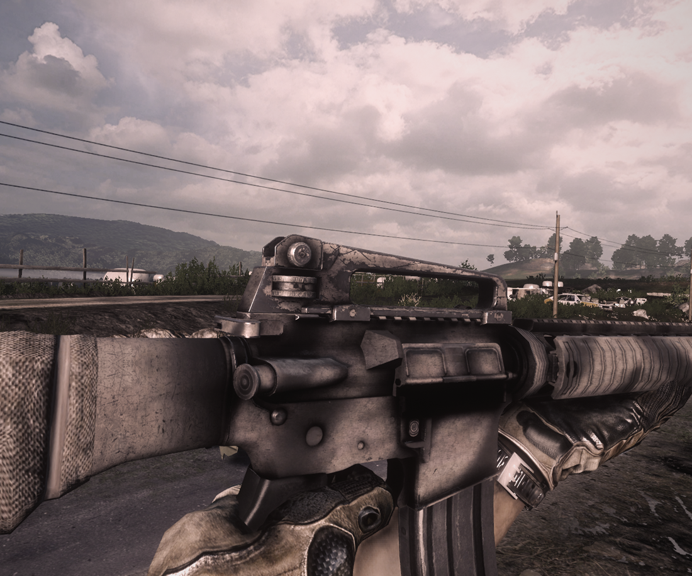

# Battlefield 3 VR: The Great Destroyer

A fan-made VR mod for the Battlefield 3 campaign on PC, played with a headset and motion controllers.

**Status: pre-alpha. There's no download yet.** The first whole mission now plays from start to end in VR, but the rest of the campaign isn't there yet, so it isn't ready to share. This page is where the progress gets posted.

**Watch it:** [4-minute gameplay clip of Rock and a Hard Place, on X](https://x.com/PCVRGamer/status/2117429358998478896)

## What works so far

- **True 3D:** the game draws a separate picture for each eye.
- **Your head moves the view:** look around, lean, duck and peek.
- **Your hands are your hands:** the gun follows your right controller, your left hand is free, and both hands can hold the rifle.
- **Weapons in your hands:** every gun in Rock and a Hard Place: the M416, M16, M4A1, AN-94, AEK-971, AK-74M, RPK-74M, G3A3, KH2002 and M240, the SMAW and the Stinger, plus the pistol from The Great Destroyer.
- **Reloading by hand, on all of them:** take a magazine from over your left shoulder and bring it to the gun. Guns with no magazine button have the old one pulled out or knocked out with the new one, then you work the lever, overhand or underhand. On the M4s and the M16 the port's flap opens and shuts, and you slap the bolt release.
- **The M240's whole reload:** lift the lid, swap the ammo box, pinch the belt with your thumb and finger and lay it in the feed, close the lid, pull the lever. The belt gets shorter as you fire.
- **The launchers too:** pull the spent case off the SMAW and load a new rocket. Lift the Stinger's aerial after each shot for the next missile.
- **Scopes that really magnify:** the zoomed view sits inside the scope's own glass, with its reticle, lines and range marks, and the rest of your view stays normal.
- **Effects from the gun you're holding:** the muzzle flash and smoke come from the barrel, and casings fly out of the ejection port.
- **Cutscenes in 3D:** your body stays in the scene while your head stays free.
- **A flat view for streaming:** OBS and Discord show a normal picture, not two eyes side by side.

## Where it's at

The first goal was one whole level, playable from start to end in VR, and it's there: **Rock and a Hard Place** now plays all the way through, from the BMPs beaten with the SMAW to shooting down the jet with the Stinger. It's still being polished, and it hasn't yet been through a full run without a hitch.

## What's next

1. The hands: any gun in either hand, grenades thrown by hand, magazines and guns that fall and bounce for real, holsters.
2. Each gun's own recoil.
3. Sharper scopes.
4. The other levels, on the same foundations.
5. HUD placement and comfort options, at the end.

## When can I play it?

There's no date yet. It'll be shared once it's ready to be played.

## Good to know

- You'll need your own copy of Battlefield 3 on PC.
- It's for the single-player campaign only, not multiplayer.
- This is a fan project, not affiliated with or endorsed by Electronic Arts or DICE. Battlefield is a trademark of Electronic Arts.
