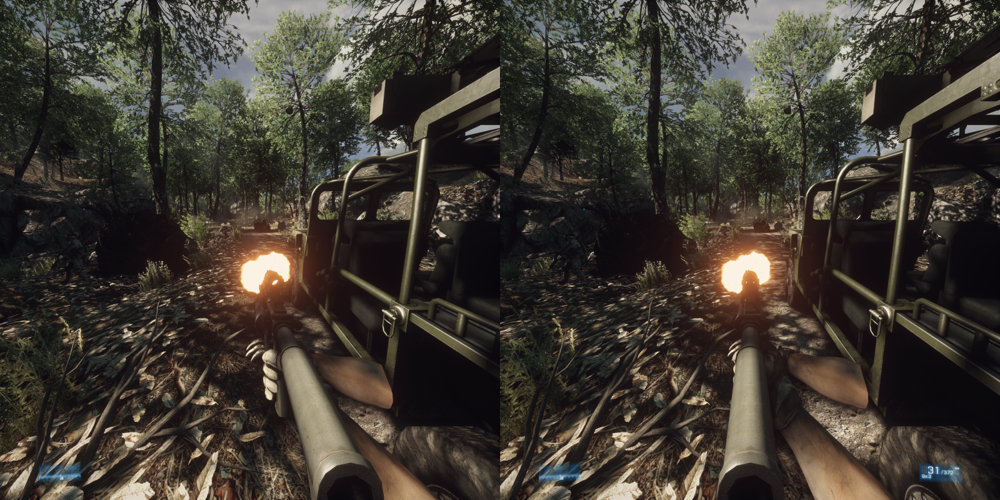
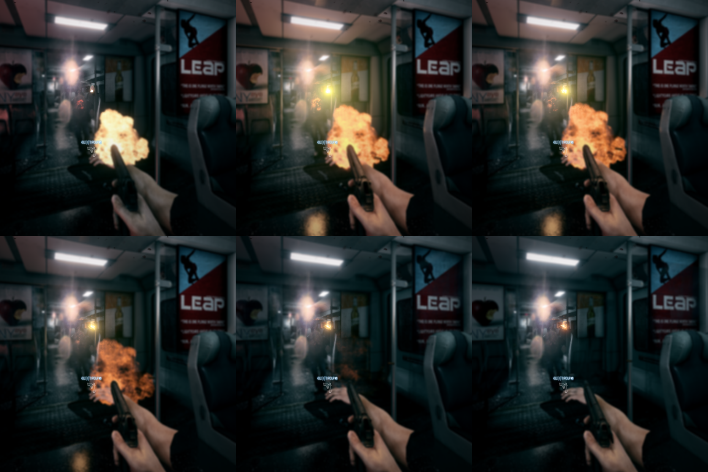

# Battlefield 3 VR: The Great Destroyer

A fan-made VR mod for the Battlefield 3 campaign on PC, played with a headset and motion controllers.

**Status: pre-alpha. There's no download yet.** Only part of the campaign works so far, so it isn't ready to share. This page is where the progress gets posted.

**Watch it:** [4-minute gameplay clip of Rock and a Hard Place, on X](https://x.com/PCVRGamer/status/2117429358998478896)

## What works so far

- **True 3D:** the game draws a separate picture for each eye.
- **Your head moves the view:** look around, lean, duck and peek.
- **Your hands are your hands:** the gun follows your right controller, your left hand is free, and both hands can hold the rifle.
- **Weapons in your hands:** the M416, the pistol from The Great Destroyer and the SMAW rocket launcher, held with the game's own grips.
- **Reloading by hand:** on the M416 and the pistol, take a magazine from your waist and push it in, then work the charging handle or the slide.
- **Effects from the gun you're holding:** the muzzle flash and smoke come from the barrel, and casings fly out of the ejection port.
- **Cutscenes in 3D:** your body stays in the scene while your head stays free.
- **A flat view for streaming:** OBS and Discord show a normal picture, not two eyes side by side.

## Where it's at

The first goal is one whole level, playable from start to end in VR: **Rock and a Hard Place**. The two BMPs can now be beaten with the SMAW. What's left to finish it is the Stinger against the jet, and more tuning of the aim.

## What's next

1. Solid aim for the rifle and the launcher.
2. Reloading the SMAW by hand.
3. The Stinger, then the whole level from start to end.
4. More guns and the other levels.
5. HUD placement and comfort options, at the end.

## When can I play it?

There's no date yet. It'll be shared once it's ready to be played.

## Good to know

- You'll need your own copy of Battlefield 3 on PC.
- It's for the single-player campaign only, not multiplayer.
- This is a fan project, not affiliated with or endorsed by Electronic Arts or DICE. Battlefield is a trademark of Electronic Arts.
